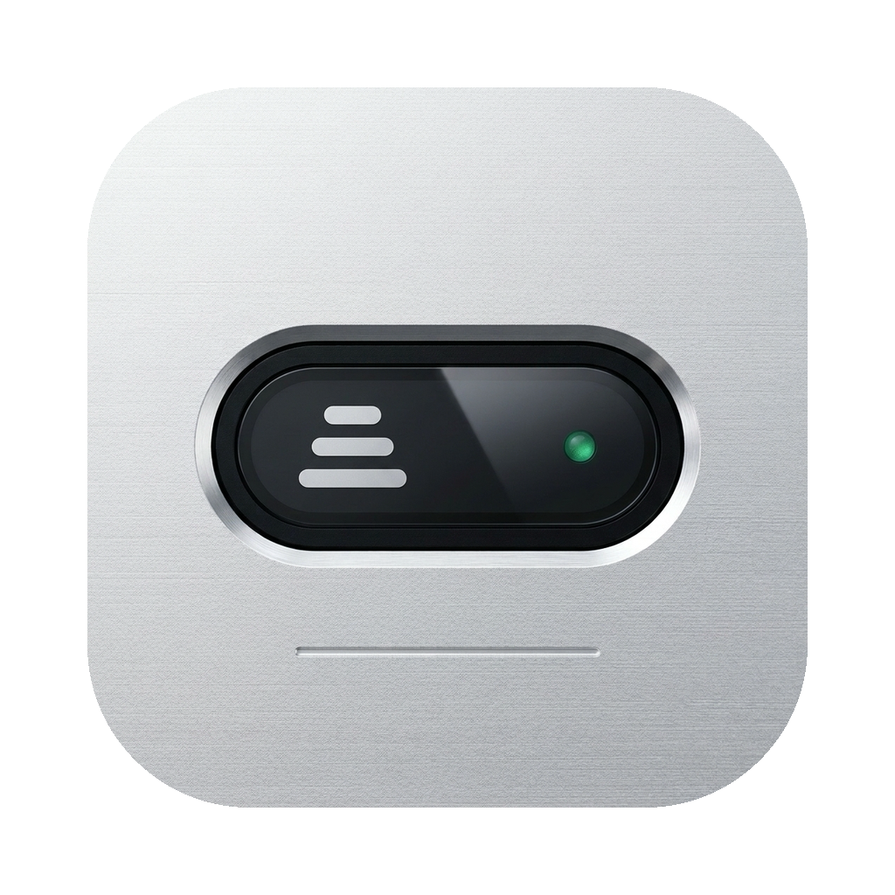
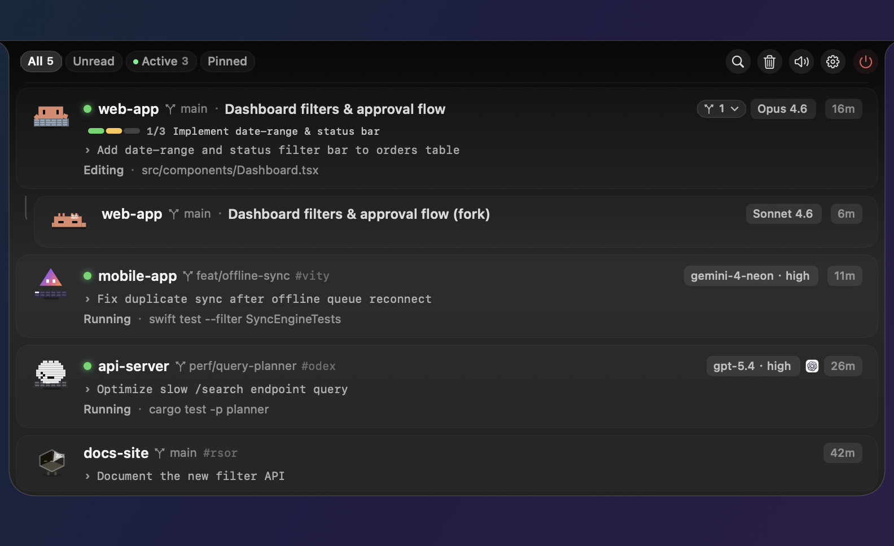
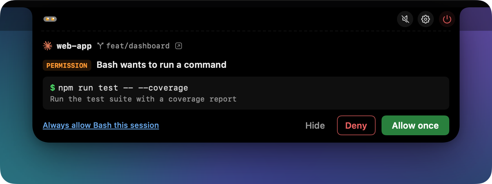
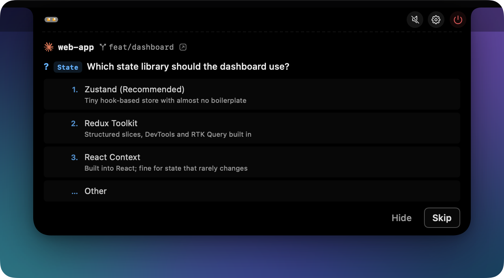
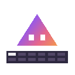
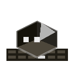
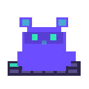
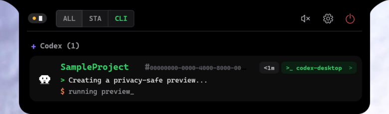

<div align="center">



# Cairn

**A minimalist macOS notch & Windows edge-island hub for your AI coding agents.**

Monitor live agent states, inspect subagent & fork trees, track task checklists, approve tool calls, and answer questions — without leaving your current window.

[English](README.md) · [简体中文](README.zh-CN.md) · [Releases](https://github.com/can-mrjin/Cairn/releases) · [Windows Client](https://github.com/can-mrjin/Cairn/blob/beta/windows/README.md) · [Changelog](CHANGELOG.md)

<br />



</div>

---

## Why Cairn?

When you run multiple AI coding agents in parallel across terminals, IDEs, and desktop apps, switching windows just to check whether a task finished — or whether an agent is blocked on a shell approval — breaks your flow. **Cairn** turns the MacBook notch (and any Windows monitor edge) into a calm, zero-noise command center.

---

## Key Features

### 1. Minimalist Collapsed Bar & Zero-Noise Alerts
- **Live Phase Indicator**: Shows the highest-priority active agent mascot on the left and its real-time status on the right (`Thinking`, `Reading`, `Editing`, `Creating`, `Running`, `Searching`, `Delegating`, `Compacting`).
- **Persistent Unread Dot**: Displays a clean emerald dot on the right wing whenever any conversation has an unread reply — even while another session is actively running.
- **Auto-Hide & Clean Menu Bar**: Optionally auto-hide the island when idle (moving your pointer over the notch still smoothly reveals and expands it) and toggle the menu bar icon on or off.

### 2. Session Hub, Branch Trees & Task Checklists
- **Fast Filtering & Search**: Filter by **All / Unread / Running / Pinned**, search across conversations, pin important cards, archive finished work, or configure per-project silence rules.
- **One-Click Context Jump**: Click any session card to jump directly back to its exact Terminal / iTerm2 / Ghostty / Warp / WezTerm tab, Cursor / VS Code / Antigravity window, or Claude Desktop conversation.
- **Subagent & Forked Branch Trees**: Automatically nests Antigravity Swarm workers, `invoke_subagent` subagents, and Claude Desktop `(fork)` / `btw:` branches into collapsible trees inside the parent card, with root-only notification options.
- **Live Task Checklists**: Renders real-time step progress (`Claude` plans, `Codex` tasks, `Antigravity` `update_steps`) inside session cards with 3 selectable visual styles in **Settings → Appearance**.
- **Adaptive Panel Height**: Automatically expands up to 85% of your screen height when viewing tall checklist cards or multiple active threads.

### 3. Inline Tool Approvals & Interactive Questions
Approve, deny, or respond to agent prompts directly from the notch without switching focus:

<div align="center">
<table>
  <tr>
    <td align="center" width="50%">
      <br />
      <sub><b>Inline Tool Approval</b> — Allow once, Deny, Batch-approve, or Always Allow for Session</sub>
    </td>
    <td align="center" width="50%">
      <br />
      <sub><b>Interactive Questions</b> — Pick an option or type a custom reply directly in the panel</sub>
    </td>
  </tr>
</table>
</div>

### 4. Customizable Appearance & Built-in Updates
- **3 Card Styles**: Switch between **Comfortable**, **Compact**, and **Minimal** layouts.
- **Surfaces & Colors**: Choose **Pure Black** or **Translucent Vibrancy**, customize accent colors, adjust collapsed notch width (`100%–150%`), expanded panel width, and hover delay — with a **Live Preview** in Settings.
- **Sparkle Auto-Updates**: Built-in updater with **Stable** and **Beta** channel selection.
- **100% Local & Private**: Uses local Unix domain sockets on macOS and user-scoped named pipes on Windows. No cloud relay, no telemetry.

---

## Supported Agents

Cairn ships with pixel-art mascots and local hook / transcript integrations for 30+ AI coding tools:

| Mascot | Agent | Integration | Mascot | Agent | Integration |
| :---: | --- | --- | :---: | --- | --- |
|  | **Claude Code / Desktop** | Hooks + Transcripts + Fork Trees |  | **Google Antigravity** | Hooks + Swarm + `invoke_subagent` |
|  | **Codex CLI / Desktop** | Hooks + Live JSONL + Deep Links |  | **Cursor** | Hooks + IDE Jump |
|  | **Gemini CLI** | Hooks |  | **OpenCode** | Generated Plugin |
|  | **Qwen Code** | Hooks |  | **Trae** | Hooks |
|  | **Qoder** | Hooks |  | **Cline** | Hooks |
|  | **GitHub Copilot CLI** | Hooks |  | **Kimi CLI** | Hooks |
|  | **Factory Droid** | Hooks |  | **CodeBuddy** | Hooks |

---

## Windows Client (`Cairn for Windows`)

Cairn also includes a native WPF client for **Windows 10 / 11 (x64)** in [`windows/`](https://github.com/can-mrjin/Cairn/blob/beta/windows/README.md), featuring edge docking across multiple monitors, global shortcuts, Codex Desktop thread jumping, Antigravity event normalization, and GitHub Releases update checking (with Beta channel support).

<div align="center">
  <br />
  
</div>

See [windows/README.md](https://github.com/can-mrjin/Cairn/blob/beta/windows/README.md) for Windows installation, shortcuts, and build instructions.

---

## Installation

### macOS (Download)

1. Download `Cairn.dmg` from [GitHub Releases](https://github.com/can-mrjin/Cairn/releases) (macOS 14+, Apple Silicon).
2. Drag `Cairn.app` into `/Applications`.
3. If macOS Gatekeeper blocks first launch on an unnotarized build, run:
   ```bash
   xattr -cr /Applications/Cairn.app
   ```
4. Launch Cairn and enable the hooks for your agents in **Settings**.

### macOS (Build from Source)

Requires macOS 14+ and Xcode / Swift 5.9+:

```bash
git clone https://github.com/can-mrjin/Cairn.git
cd Cairn
swift build
```

To build a standalone `.app` bundle:

```bash
./scripts/build.sh
```

### Windows

Download `Cairn-Windows-<version>-win-x64.zip` from [GitHub Releases](https://github.com/can-mrjin/Cairn/releases) or the `cairn-windows` GitHub Actions artifact (requires [.NET 8 Desktop Runtime](https://dotnet.microsoft.com/download/dotnet/8.0)). Full guide in [windows/README.md](https://github.com/can-mrjin/Cairn/blob/beta/windows/README.md).

---

## License & Acknowledgements

Released under the [GNU General Public License v3.0](LICENSE) (`GPL-3.0`). Any redistributed modifications or derivative works must also be released under GPL-3.0.

Built upon [wxtsky/CodeIsland](https://github.com/wxtsky/CodeIsland) (original MIT copyright notice preserved in [docs/THIRD_PARTY_LICENSES.md](docs/THIRD_PARTY_LICENSES.md)) — thanks to `@wxtsky` and all contributors for the original foundation and hook ecosystem.
