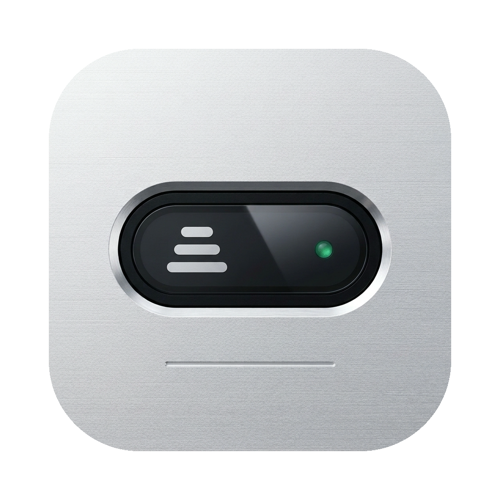

<div align="center">



# Cairn

在 Mac 刘海里统一管理你的 AI 编程对话。

[English](README.md) · [简体中文](README.zh-CN.md) · [下载 Releases](https://github.com/zepeng-jin/Cairn/releases)

</div>

---

## 功能介绍

- **简洁收起态**：刘海左侧展示当前最活跃或最高优先级的 Agent，右侧实时显示当前动作（思考中、阅读中、编辑中、创建中、运行中、检索中、协作中、压缩中等）；有未读回复时仅以绿点提示。
- **会话中心**：悬停或点击即可展开查看当日会话，支持在顶栏按「全部 / 未读 / 运行中 / 置顶」筛选与快速搜索，支持未读状态管理、置顶、归档与静默规则；点击卡片可直接跳回对应的终端标签页、IDE 窗口或 Claude Desktop 对话。
- **直接审批与回复**：无需切回终端或编辑器，即可在面板内单条或批量批准/拒绝工具调用、开启本轮自动放行，或直接回答 Agent 的提问。
- **任务与子 Agent 视图**：卡片内展示任务清单进度与子 Agent 树形结构（支持 Antigravity Swarm 子任务折叠与仅主会话提醒）。
- **自定义外观与交互**：支持舒适 / 精简 / 极简三种卡片样式、纯黑与毛玻璃质感、自定义强调色、展开宽度与悬停延迟调节，设置页提供实时预览。
- **多工具本地适配**：支持 Claude Code（CLI / Desktop / Cowork / 3P）、Google Antigravity、Codex、Cursor、Windsurf、Gemini CLI、OpenCode、Qwen Code、Trae、Qoder、Cline 等 30+ AI 编程工具。纯本地运行，无云端中转与遥测。

## 安装方式

### 直接下载

1. 前往 [GitHub Releases](https://github.com/zepeng-jin/Cairn/releases) 下载最新 `Cairn.dmg`（macOS 14+，Apple Silicon）。
2. 将 `Cairn.app` 拖入 `/Applications`。
3. 首次打开如遇系统未公证拦截，在终端执行：
   ```bash
   xattr -cr /Applications/Cairn.app
   ```
4. 打开应用后，在「设置」中按需开启对应工具的 Hook 即可。

### 从源码构建

需要 macOS 14+ 与 Xcode / Swift 5.9+：

```bash
git clone https://github.com/zepeng-jin/Cairn.git
cd Cairn
swift build
```

打包独立 `.app` 应用：

```bash
./build.sh
```

## 开源协议与致谢

本项目基于 [GNU GPL v3.0](LICENSE) 开源：任何修改或衍生版本在对外分发时均须同样以 GPL-3.0 协议开放完整源代码。

衍生自 [wxtsky/CodeIsland](https://github.com/wxtsky/CodeIsland)（上游原始 MIT 版权与许可声明完整保留在 [THIRD_PARTY_LICENSES.md](THIRD_PARTY_LICENSES.md)），感谢原作者 `@wxtsky` 及社区贡献者奠定的基础与多工具 Hook 生态。
