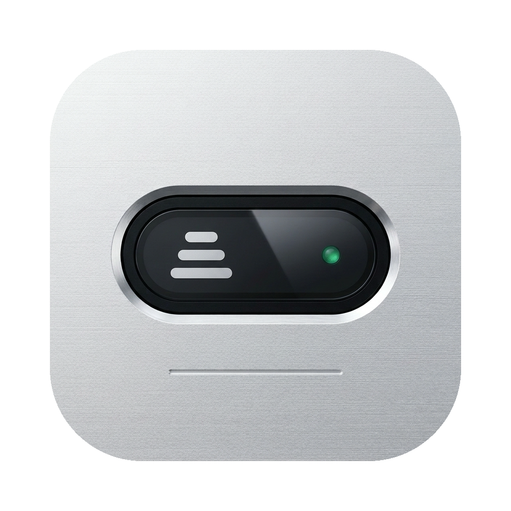
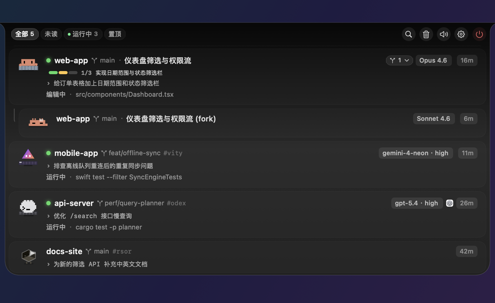
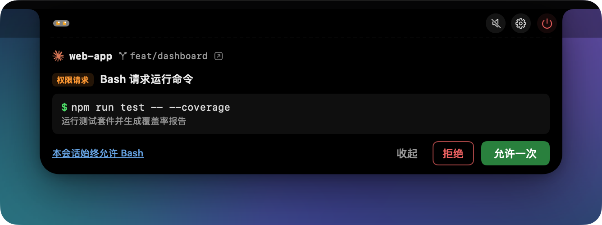
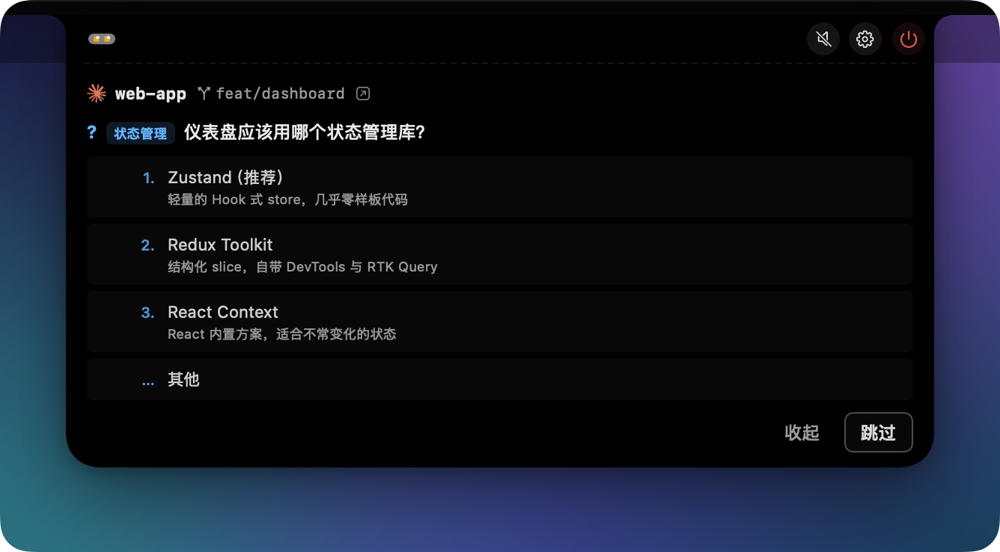
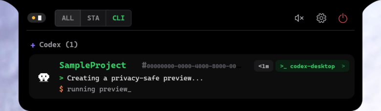

<div align="center">



# Cairn

**在 Mac 刘海与 Windows 屏幕边缘统一管理你的 AI 编程对话。**

实时查看各 Agent 运行状态、折叠查看子 Agent 与分支树、跟踪任务清单进度，并直接在面板内完成工具审批与问题回复，无需频繁切回终端或编辑器。

[English](README.md) · [简体中文](README.zh-CN.md) · [下载 Releases](https://github.com/can-mrjin/Cairn/releases) · [Windows 版文档](windows/README.zh-CN.md) · [更新日志](CHANGELOG.md)

<br />



</div>

---

## 为什么做 Cairn？

当你同时在终端、IDE 和桌面端运行多个 AI 编程 Agent 时，只是为了看一眼“写完没有”或“是不是卡在命令授权了”，就得来回切换窗口。**Cairn** 把 MacBook 刘海（以及 Windows 屏幕边缘）变成一个安静、克制、信息密度恰到好处的本地状态中心。

---

## 核心功能

### 1. 极简收起态与零打扰提醒
- **实时阶段状态**：收起态左侧展示当前优先级最高的活跃 Agent 像素形象，右侧实时显示当前动作（思考中、阅读中、编辑中、创建中、运行中、检索中、协作中、压缩中）。
- **右侧常驻未读绿点**：只要任意会话有未读回复，右侧始终保留一颗干净的绿点提示；即使其他会话正在运行也不会被覆盖。
- **空闲自动隐藏与极简菜单栏**：支持开启「无活跃会话时自动隐藏」（鼠标移至刘海区域仍可平滑唤出面板），并可自由开关顶部菜单栏图标。

### 2. 会话中心、分支树与任务清单
- **筛选与检索**：顶栏支持按「全部 / 未读 / 运行中 / 置顶」筛选与关键词搜索，支持置顶、归档与按项目配置静默规则。
- **一键直达原窗口**：点击会话卡片即可直接跳回对应的 Terminal / iTerm2 / Ghostty / Warp / WezTerm 标签页、Cursor / VS Code / Antigravity 窗口或 Claude Desktop 对话。
- **子 Agent 与分支树折叠**：自动将 Antigravity Swarm 成员、`invoke_subagent` 子代理以及 Claude Desktop 的 `(fork)` / `btw:` 分支会话折叠进主对话树，并支持「仅主对话提醒」静音策略。
- **实时任务清单**：在卡片内直接展示进度清单（兼容 `Claude` 计划、`Codex` 任务与 `Antigravity` `update_steps`），并在「设置 → 外观」提供三种卡片/进度展示风格。
- **自适应展开高度**：当卡片内含长任务清单或多条并行分支时，面板最高可自适应展开至屏幕高度的 85%。

### 3. 面板内直接审批与回复
无需切回终端或 IDE，在刘海面板中即可直接处理工具调用授权与多选/文本提问：

<div align="center">
<table>
  <tr>
    <td align="center" width="50%">
      <br />
      <sub><b>工具权限审批</b> — 支持允许一次、拒绝、批量审批与本会话始终允许</sub>
    </td>
    <td align="center" width="50%">
      <br />
      <sub><b>交互式提问回复</b> — 直接在面板中选择推荐方案或输入自定义回复</sub>
    </td>
  </tr>
</table>
</div>

### 4. 外观定制与内置更新
- **三种卡片样式**：支持 **舒适 / 精简 / 极简** 三种布局切换。
- **材质与尺寸微调**：支持 **纯黑** 与 **毛玻璃** 质感、自定义强调色、刘海收起宽度（`100%–150%`）、展开面板宽度与悬停延迟调节，并在设置页提供实时预览。
- **Sparkle 自动更新**：支持后台自动下载更新，并提供 **正式版 / Beta 预览版** 通道切换。
- **100% 本地运行**：macOS 端通过本地 Unix Socket 通信，Windows 端通过当前用户隔离的命名管道通信，无云端中转与遥测。

---

## 支持的 AI 编程工具

内置 30+ 工具的本地 Hook / 会话记录监听与像素风形象：

| 形象 | 工具 | 接入能力 | 形象 | 工具 | 接入能力 |
| :---: | --- | --- | :---: | --- | --- |
|  | **Claude Code / Desktop** | Hook + 会话记录 + Fork 分支树 |  | **Google Antigravity** | Hook + Swarm + `invoke_subagent` |
|  | **Codex CLI / Desktop** | Hook + 实时 JSONL + 线程深链接 |  | **Cursor** | Hook + IDE 窗口跳转 |
|  | **Gemini CLI** | Hook |  | **OpenCode** | 自动生成插件 |
|  | **Qwen Code** | Hook |  | **Trae** | Hook |
|  | **Qoder** | Hook |  | **Cline** | Hook |
|  | **GitHub Copilot CLI** | Hook |  | **Kimi CLI** | Hook |
|  | **Factory Droid** | Hook |  | **CodeBuddy** | Hook |

---

## Windows 客户端（`Cairn for Windows`）

仓库 [`windows/`](windows/README.zh-CN.md) 目录同时提供原生 **Windows 10 / 11 (x64)** WPF 客户端，支持多显示器四边贴靠、全局快捷键、Codex Desktop 线程跳转、Antigravity 事件标准化以及 GitHub Releases 更新检查（含 Beta 通道开关）。

<div align="center">
  <br />
  
</div>

Windows 端的安装、快捷键与源码构建请见 [windows/README.zh-CN.md](windows/README.zh-CN.md)。

---

## 安装方式

### macOS 直接下载

1. 前往 [GitHub Releases](https://github.com/can-mrjin/Cairn/releases) 下载最新 `Cairn.dmg`（macOS 14+，Apple Silicon）。
2. 将 `Cairn.app` 拖入 `/Applications`。
3. 首次打开如遇系统未公证拦截，在终端执行：
   ```bash
   xattr -cr /Applications/Cairn.app
   ```
4. 打开应用后，在「设置」中按需开启对应工具的 Hook 即可。

### macOS 从源码构建

需要 macOS 14+ 与 Xcode / Swift 5.9+：

```bash
git clone https://github.com/can-mrjin/Cairn.git
cd Cairn
swift build
```

打包独立 `.app` 应用：

```bash
./scripts/build.sh
```

### Windows

前往 [GitHub Releases](https://github.com/can-mrjin/Cairn/releases) 或 GitHub Actions 的 `cairn-windows` 产物下载 `Cairn-Windows-<version>-win-x64.zip`（需安装 [.NET 8 Desktop Runtime](https://dotnet.microsoft.com/zh-cn/download/dotnet/8.0)）。详细步骤见 [windows/README.zh-CN.md](windows/README.zh-CN.md)。

---

## 开源协议与致谢

本项目基于 [GNU GPL v3.0](LICENSE) 开源：任何修改或衍生版本在对外分发时均须同样以 GPL-3.0 协议开放完整源代码。

衍生自 [wxtsky/CodeIsland](https://github.com/wxtsky/CodeIsland)（上游原始 MIT 版权与许可声明完整保留在 [docs/THIRD_PARTY_LICENSES.md](docs/THIRD_PARTY_LICENSES.md)），感谢原作者 `@wxtsky` 及社区贡献者奠定的基础与多工具 Hook 生态。
